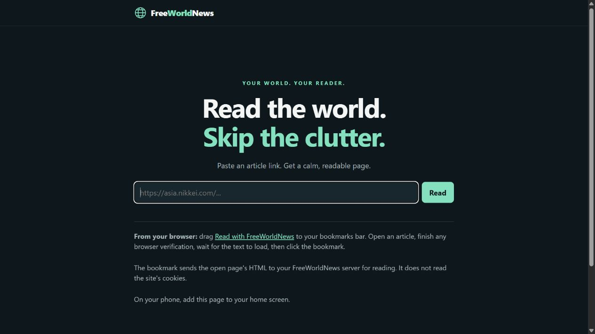
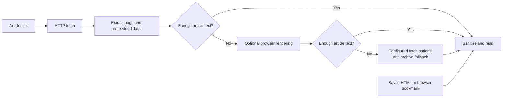

<p align="center">
  
</p>

<p align="center">
  <a href="https://github.com/K0rnhulio/FreeWorldNews/actions/workflows/go.yml"></a>
  <a href="LICENSE"></a>
  
  
</p>

<p align="center"><b>Your news. Your server. Your space to think.</b></p>

FreeWorldNews turns article links into calm, readable pages. It looks for the
story in the page, embedded data, an optional real browser, and available
archive snapshots—then keeps the text, headings, images, and links that matter.

**Paste a link. Find the article. Make room to read.**

## What makes it different

- **Finds text beyond the visible preview.** Extracts embedded JSON, Next.js
  article bodies, and Arc/Fusion content blocks in reading order.
- **A browser when you need one.** Optional Patchright rendering runs a real
  Chromium engine. Installed Chrome can run visibly on your desktop.
- **Learns what works.** Remembers successful fetch strategies, backs off after
  verification pages, and respects server rate limits.
- **Reads what you already opened.** Import saved HTML or use the browser
  bookmark. Imported content is sanitized without running its scripts.
- **Built for your own server.** Go application, light/dark reader, bounded
  memory cache, and no required external extraction service.
- **Keeps the original toolkit.** Optional DNS, reverse proxy, DNS over TLS,
  and domain-based blocking remain available for advanced setups.

<details>
<summary>Take a look at the reader</summary>



</details>

## Start reading

Install a current Go release. CI builds with Go 1.27 on Linux and Windows.

```sh
git clone https://github.com/K0rnhulio/FreeWorldNews.git
cd FreeWorldNews
go build -o freeworldnews .
./freeworldnews -readerOnly
```

Open **[localhost:8080](http://localhost:8080)** and paste an article link.
Reader-only mode needs no DNS changes, privileged ports, or CA installation.

On Windows:

```powershell
go build -o freeworldnews.exe .
.\freeworldnews.exe -readerOnly
```

To use another reader port, add `-readerPort 8088`.

## Add browser rendering

Install Node.js 20+ for the optional browser worker:

```sh
cd browser
npm ci
npm run install-browser
cd ..
./freeworldnews -readerOnly -readerBrowser browser/render.mjs
```

For **visible Google Chrome** on Windows, install Chrome and run:

```powershell
.\freeworldnews.exe -readerOnly -readerBrowser browser/render.mjs -readerBrowserChannel chrome -readerBrowserHeadful
```

On Linux, install browser system dependencies with
`npx patchright install --with-deps chromium` from `browser/`. Run the application
as a regular user so Chromium's sandbox can stay enabled. The default browser
mode is headless; visible mode needs a desktop session.

## Run with Docker

```sh
docker compose up --build -d
```

Open **[localhost:8080](http://localhost:8080)**. The default container runs the
lightweight reader. Browser rendering requires the native Node.js/Chromium
setup above; it is not included in this image.

## How a link becomes a story



The reader remembers a successful approach for each hostname for 30 minutes.
An explicit `from_archive` host setting takes priority. Browser rendering is
skipped when a server asks requests to slow down.

## What to expect

FreeWorldNews can extract article text that a publisher delivers in HTML or
embedded data, including text hidden behind some client-side previews. It
cannot recover text that was never delivered. Browser verification can still
block requests, and the worker does not click CAPTCHAs.

HTTP articles may be cached for up to five minutes within a 64-entry, 4 MB
budget. Private/no-store/no-cache responses, browser-rendered articles, and
imports do not enter the shared cache. Browser workers use fresh temporary
profiles and public-address-only network access.

## Go deeper

- [Configuration, DNS, proxy, and service setup](docs/advanced.md)
- [Development, tests, and extraction diagnostics](docs/development.md)
- [Contributing](CONTRIBUTING.md)
- [Report a site or reader issue](https://github.com/K0rnhulio/FreeWorldNews/issues/new/choose)

## Roots and license

FreeWorldNews builds on [fipso/freenews](https://github.com/fipso/freenews),
with a new identity and an expanded article reader, browser fallback, and
structured-data extraction. Thank you to the original authors and contributors.

Browser rendering uses [Patchright](https://github.com/Kaliiiiiiiiii-Vinyzu/patchright).
The original proxy compression work credits
[Modlishka](https://github.com/drk1wi/Modlishka).

Distributed under the [GNU General Public License v3](LICENSE). The upstream
license is preserved.
